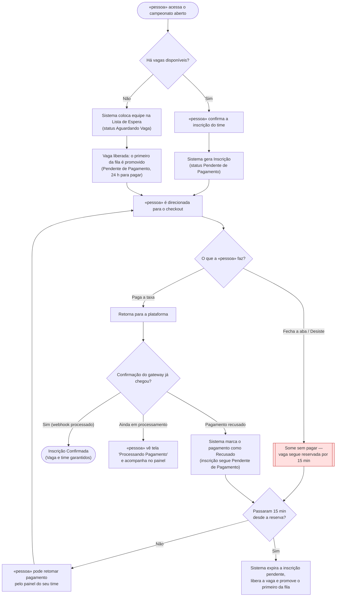

# 🗺️ Jornadas de Usuário

**Projeto:** Sistema de Inscrição para Campeonatos de E-sports  
**Versão:** 1.1.0  
**Última atualização:** 2026-10-14  

> 🤖 **Este documento é a fonte da verdade sobre O QUE A PESSOA VIVE na tela** —
> o caminho do primeiro clique até o objetivo, e principalmente os pontos onde ela
> trava, espera ou desiste.
>
> ✍️ **Não preencha na mão:** rode `/utf-flows`. A entrevista escolhe a história que
> merece o desenho, obriga o ponto de desistência a aparecer e cobra a decisão sobre
> ele.
>
> 🚫 **Não duplique:** regra de negócio mora no `prd.md`; estado, entidade e contrato
> moram no `architecture.md`. Aqui mora o caminho.

---

## Jornada 1 — Inscrição e Pagamento da Taxa

**Story:** US03, US04, US05  
**Critérios que ela marca:** Sai do site e volta · Depende do tempo · Depende de outra pessoa/agente agir · Pode ser abandonada no meio (4/4)

**O que decidimos sobre o nó vermelho:**

Se o capitão fechar a aba ou desistir no checkout, a inscrição fica "Pendente de Pagamento" e a vaga continua reservada ao time por 15 minutos, contados da confirmação da inscrição; as telas de detalhes, confirmação, checkout e processamento mostram esse cronômetro. Dentro dos 15 minutos o capitão pode voltar pelo painel do time e concluir o pagamento. Passado o tempo, o sistema cancela a inscrição por expiração, libera a vaga e promove o primeiro da lista de espera (US04, RN02 e RN09); o capitão pode refazer a inscrição se ainda houver vaga. O time promovido da lista de espera tem uma janela maior, de 24 horas contadas da promoção (RN07), porque a vaga costuma ser liberada quando o prazo do campeonato já está acabando. Se o pagamento for recusado, a inscrição continua pendente e o capitão pode tentar de novo enquanto a reserva durar.

---

## Dúvidas em aberto

Nenhuma. A dúvida sobre quanto tempo o time promovido da lista de espera tem para pagar foi resolvida: 24 horas contadas da promoção (RN07 do `docs/prd.md`).
